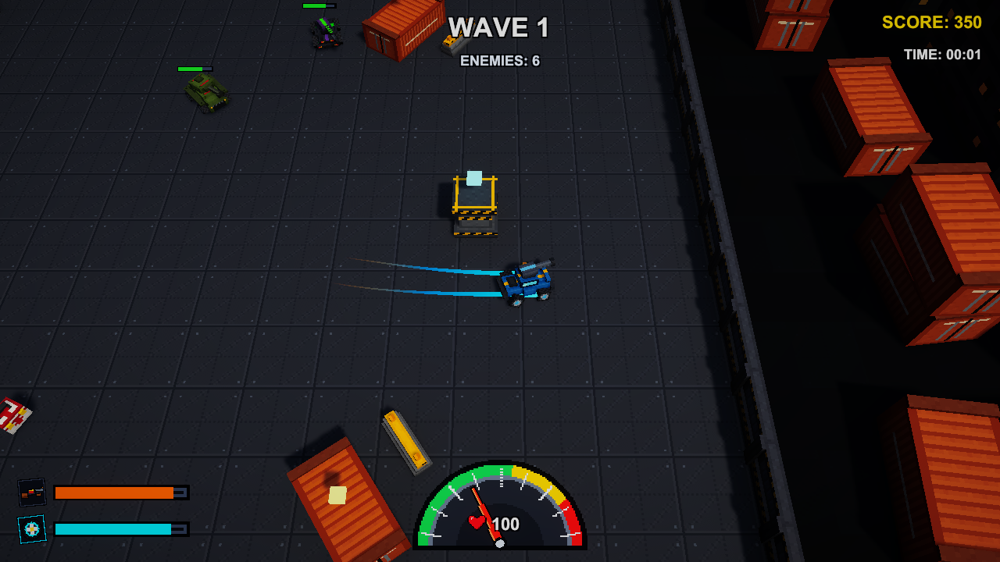
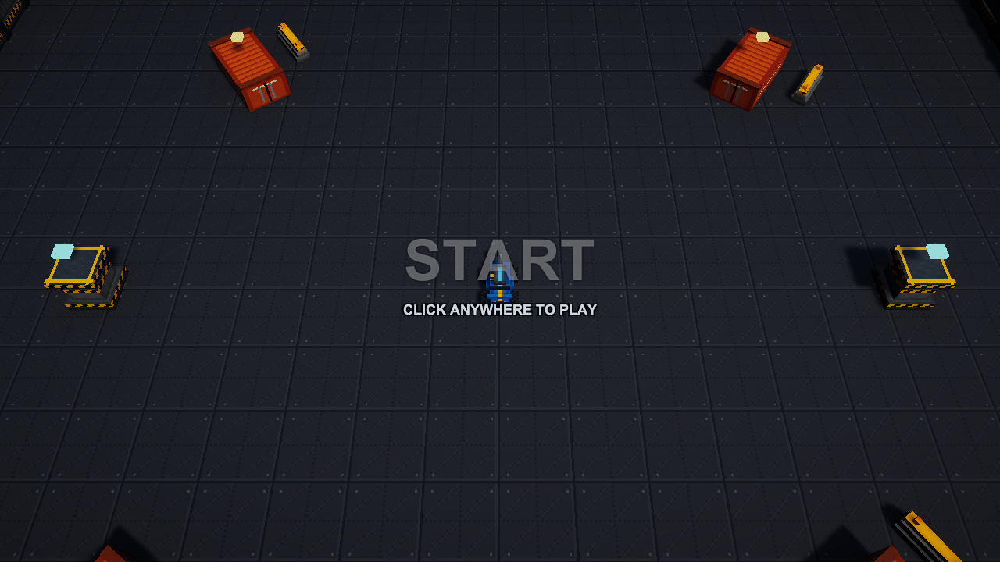
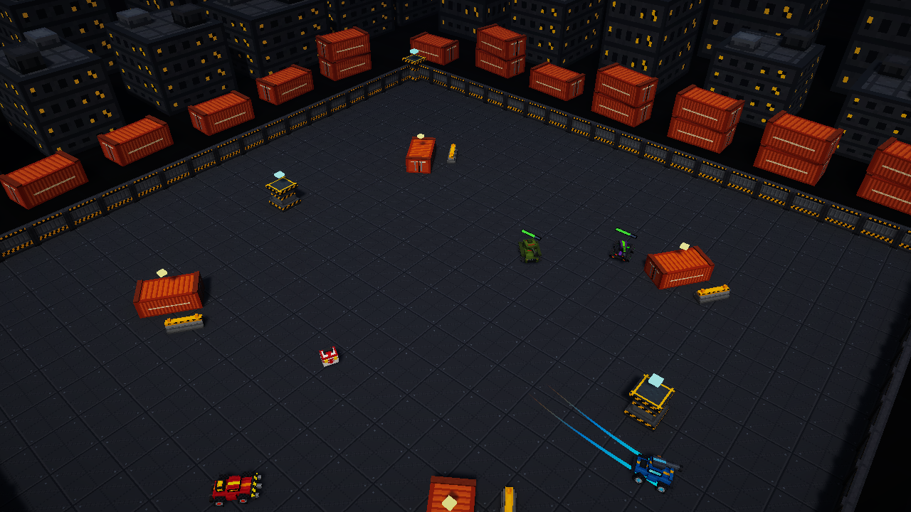

# Vehicular Combat (2026)

[中文](#中文) | [Español](#español) | [English](#english)

A top-down low-poly vehicular combat game built in Unity 6 (URP) with Blockbench pixel-art models, `WheelCollider` physics, recoil-driven gunplay, and 8-bit procedural sound effects.

---

## 中文

### 游戏简介
这是一款基于 **Unity 6 (URP)** 制作的 3D 俯视角低模像素风载具射击游戏。所有载具、武器道具与竞技场场景均在 Blockbench 中按 1:1 像素密度建模。玩家驾驶武装战车在封闭工业竞技场内迎战 3 波递增的敌人，利用开火后坐力和随机刷新的道具完成走位、漂移与反击。

### 画面预览

| 开始界面 | 竞技场光照与场景 |
| :---: | :---: |
|  |  |

### 怎么玩（操作说明）
1. 进入游戏后，点击屏幕任意位置（`START`）即可开始第 1 波战斗。
2. **移动与驾驶**：`W / A / S / D` 或方向键控制加速、刹车/倒车与转向（车速越高转向角越稳）。
3. **炮台瞄准**：移动鼠标，炮台会平滑绕 Y 轴瞄准地面光标位置。
4. **开火与后坐力推车**：按住或点击 **鼠标左键** 射击。每次开火都会对车身施加相反方向的水平后坐力脉冲——你可以用它急刹、快速横向闪避，或者在高速转弯时辅助甩尾。
5. **暂停**：按 `ESC` 键打开暂停菜单，可随时继续、重开或退出。

### 道具与武器
场地内每隔几秒会在安全空地随机刷新道具（场上最多同时存在 3 个），开车碾过即可拾取：
- **霰弹枪 (Shotgun)**：扇形 6 发散射，单发爆发高且附带极强后坐力，适合贴脸清怪或一键急刹躲避冲锋（限时，重复拾取刷新时间）。
- **机枪 (MachineGun)**：按住左键高频连发，持续的轻度后坐力可以当成推进器或线性刹车使用（限时）。
- **漂移轮胎 (DriftTires)**：临时提升最高车速与动力，同时降低后轮侧向抓地力并开启双后轮青橙霓虹拖尾，轻松甩尾漂移（限时）。
- **修理箱 (RepairKit)**：立刻回复玩家血量（不超过上限 100）。

### 敌人与波次
共 **3 个递增波次**（清完当前波次 3 秒后自动进入下一波，全清即胜利）：
- **追击者 (Kamikaze)**：血薄跑得快，直线冲向玩家并自爆造成伤害与击退。
- **狙击手 (Sniper)**：保持中远距离风筝走位，独立炮台持续锁定并发射醒目的慢速狙击弹。
- **重型坦克 (Tank)**：高血量慢速逼近，每隔几秒停顿蓄力瞄准后发动直线高速冲锋。

### 下载与运行（Windows）
1. 打开本仓库右侧的 **[Releases](../../releases)** 页面。
2. 下载最新版本的 `VehicularCombat_Win64.zip` 并解压到任意文件夹。
3. 双击运行 `VehicularCombat.exe` 即可游玩。

---

## Español

### Acerca del juego
Juego 3D de combate vehicular en vista cenital con estética low-poly pixel art, desarrollado en **Unity 6 (URP)** con modelos hechos en Blockbench, físicas reales con `WheelCollider`, retroceso físico al disparar y efectos de sonido 8-bit generados por código.

### Capturas

| Pantalla de inicio | Iluminación y arena |
| :---: | :---: |
|  |  |

### Cómo jugar (Controles)
1. Al iniciar el juego, haz **clic en cualquier lugar de la pantalla (`START`)** para comenzar la oleada 1.
2. **Conducción**: `W / A / S / D` o teclas de flecha para acelerar, frenar/reversa y girar.
3. **Apuntado**: Mueve el ratón para rotar la torreta suavemente hacia el cursor.
4. **Disparo y retroceso (Recoil)**: **Clic izquierdo** para disparar. Cada disparo empuja el vehículo en dirección opuesta en el plano horizontal; puedes aprovechar el retroceso para frenar en seco, esquivar embestidas o derrapar más rápido.
5. **Pausa**: Pulsa `ESC` para abrir el menú de pausa (`RESUME`, `RESTART`, `QUIT`).

### Objetos (Pickups)
Aparecen periódicamente en la arena (máximo 3 activos a la vez). Pasa por encima con el coche para recogerlos:
- **Escopeta (Shotgun)**: Dispara 6 proyectiles en abanico con un retroceso muy fuerte, ideal para frenazos bruscos o daño cercano (temporal).
- **Ametralladora (MachineGun)**: Fuego rápido continuo al mantener clic izquierdo; su retroceso constante sirve para impulsarte o controlar la velocidad (temporal).
- **Neumáticos de derrape (DriftTires)**: Aumenta la velocidad máxima y el par motor mientras reduce el agarre trasero y activa estelas traseras luminosas para derrapar con facilidad (temporal).
- **Kit de reparación (RepairKit)**: Restaura puntos de vida al instante (hasta 100).

### Enemigos y oleadas
Sobrevive y limpia **3 oleadas** progresivas para ganar:
- **Kamikaze**: Rápido y con poca vida; te persigue en línea recta y explota al chocar.
- **Sniper**: Mantiene distancia media/larga, apunta con su torreta independiente y dispara proyectiles lentos y visibles.
- **Tank**: Gran cantidad de vida; patrulla despacio, se detiene un instante para cargar y embiste en línea recta a gran velocidad.

### Descargar y jugar (Windows)
1. Ve a la sección **[Releases](../../releases)** de este repositorio.
2. Descarga `VehicularCombat_Win64.zip` y extráelo en una carpeta.
3. Ejecuta `VehicularCombat.exe`.

---

## English

### Overview
A top-down 3D low-poly vehicular shooter built with **Unity 6 (URP)**. All vehicles, pickups, and arena props were modeled in Blockbench with strict 1:1 pixel density. Drive an armed car inside an enclosed industrial arena, fight through 3 escalating enemy waves, and use weapon recoil plus timed pickups to drift, dodge, and clear the arena.

### Screenshots

| Start Screen | Arena Lighting & Layout |
| :---: | :---: |
|  |  |

### How to Play (Controls)
1. Launch the game and **click anywhere on the screen (`START`)** to begin Wave 1.
2. **Drive**: `W / A / S / D` or Arrow Keys to accelerate, brake/reverse, and steer (steering tightens automatically at high speeds).
3. **Aim Turret**: Move the mouse to rotate the turret smoothly toward the ground cursor.
4. **Shoot & Recoil Mechanics**: Click or hold **Left Mouse Button** to fire. Every shot applies a horizontal recoil impulse opposite to your aim direction—use it to hard-brake, sidestep incoming charges, or kick out your tail mid-drift.
5. **Pause**: Press `ESC` to toggle the pause menu (`RESUME`, `RESTART`, `QUIT`).

### Pickups
Pickups spawn randomly at open points in the arena (up to 3 active at once). Drive over them to collect:
- **Shotgun**: Fires a 6-pellet spread with massive knockback recoil—great for burst damage or emergency braking (timed; picking up again refreshes duration).
- **MachineGun**: High-rate full-auto fire with continuous light recoil that doubles as a thruster or smooth brake (timed).
- **DriftTires**: Temporarily boosts top speed and torque while lowering rear-wheel lateral grip and lighting up dual rear neon trails for snappy oversteer drifting (timed).
- **RepairKit**: Immediately restores HP (capped at 100).

### Enemies & Waves
Clear **3 escalating waves** (3-second break between waves) to win:
- **Kamikaze**: Low HP, high speed; chases you down and self-destructs on impact with knockback.
- **Sniper**: Medium HP; kites at mid-range while tracking you with its turret and firing bright, dodgeable bolts.
- **Tank**: High HP, slow advance; pauses briefly to telegraph and lock on, then charges straight forward at high speed.

### Download & Run (Windows)
1. Open the **[Releases](../../releases)** page of this repository.
2. Download `VehicularCombat_Win64.zip` and extract it anywhere.
3. Run `VehicularCombat.exe`.
